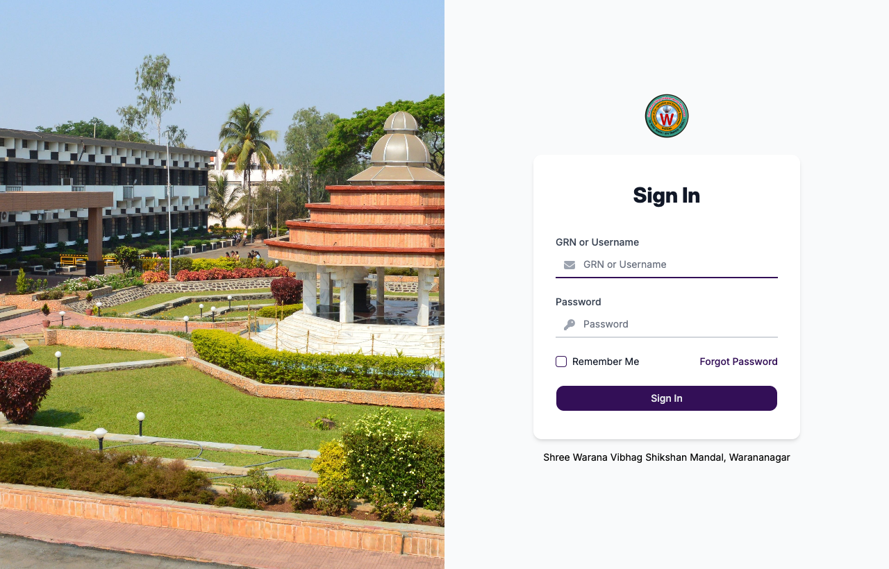
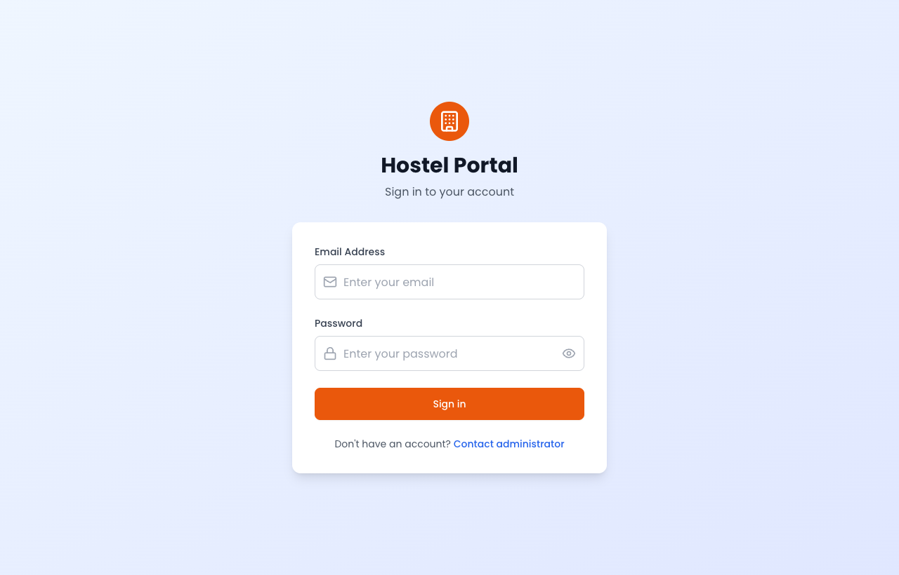

# 🧪 QA / Manual Testing Portfolio — Ketan Gote

Manual & functional testing work on **cloud-based education ERP platforms** built on the **InstituteSync** product suite. This portfolio contains **sample QA artifacts** — test plans, test cases, bug reports and UAT documentation — representative of my day-to-day testing process.

> ℹ️ The applications under test are proprietary products. This repo contains **my own QA documentation and process artifacts** (test cases, bug reports, test plans) — it does **not** contain any application source code. Sensitive data has been removed/anonymised.

---

## 🧭 Projects Tested

### 1. InstituteSync — College ERP (TKIET)
🔗 https://tkiet.institutesync.com

Cloud college ERP for Tatyasaheb Kore Institute of Engineering & Technology, covering **admissions, fees, attendance, examinations and reporting**.

**My role:** Led manual functional & regression testing, authored test cases, and tracked defects to closure across release cycles.



### 2. InstituteSync — Hostel Portal
🔗 https://hostel.institutesync.com

Hostel management system for **room allocation, resident records, fee collection and mess management**.

**My role:** Executed end-to-end test cases, validated role-based workflows, and supported UAT sign-off.



---

## 🎯 What I Tested

| Area | Coverage |
|------|----------|
| **Functional** | Admissions, Fees, Attendance, Examinations, Room Allocation, Mess, Reports |
| **Authentication & RBAC** | Login/logout, password rules, role-based access (Admin / Staff / Warden / Student) |
| **Forms & Validation** | Field validation, boundary values, negative & edge cases |
| **Regression & Smoke** | Pre-release regression suites, post-deploy smoke checks |
| **Cross-browser / Responsive** | Chrome, Firefox, Edge + mobile viewports |
| **Reports & Data** | Report generation, data accuracy, calculations (fees, dues, attendance %) |
| **UAT** | User Acceptance Testing with institute staff & sign-off |

---

## 🗂️ Repository Structure

```
qa-testing-portfolio/
├── test-plans/
│   └── InstituteSync-ERP-Test-Plan.md      # Master test plan
├── test-cases/
│   ├── login-authentication.md             # Auth + RBAC test cases
│   ├── admissions-module.md                # Admissions workflow
│   ├── fees-module.md                      # Fee collection & receipts
│   └── hostel-room-allocation.md           # Hostel allocation workflow
├── bug-reports/
│   └── sample-bug-reports.md               # Sample defect reports
└── screenshots/                            # Evidence / annotated screenshots
```

---

## 🧪 My QA Process

1. **Understand requirements** → review specs / walkthroughs with the team
2. **Design test cases** → positive, negative, boundary & edge scenarios
3. **Prepare test data** → valid/invalid datasets per module
4. **Execute** → functional → smoke → regression cycles
5. **Log defects** → clear repro steps, screenshots, severity & priority
6. **Retest & regression** → verify fixes, guard against regressions
7. **UAT support** → run acceptance scenarios with end users, assist sign-off

---

## 🛠️ Tools & Techniques

- **Test design:** Equivalence partitioning, boundary value analysis, decision tables, state transition
- **Types:** Functional, regression, smoke, sanity, UAT, cross-browser, responsive, form-validation, API
- **Tracking:** Structured bug reports with severity/priority, status workflow, retest cycles
- **API checks:** Postman (request/response validation, status codes, field validation)

---

## 📬 Contact

**Ketan Gote** · QA / Manual Testing Engineer
📧 ketangote2@gmail.com · 💼 [LinkedIn](https://www.linkedin.com/in/ketan-gote-535b76111)
